# Kitchen Buddy: 17-photo review gallery

**Review-branch images, not deployed.** Every image is an actual file bundled with the app and sized to 800×600. Click each photographer/source link to inspect attribution and image rights. The cooking instructions in this initial set have **no verifiable original recipe page** recorded; do not interpret the photographs below as photos from those exact instructions.

**Review checklist:** Does the picture visibly include the key ingredients? Is the finished dish appetizing and not an empty pan? Are the mobile 4:3 crop and framing useful? Mark discrepancies before approving release.

### 1. Garlic Chicken & Cheesy Brown Rice

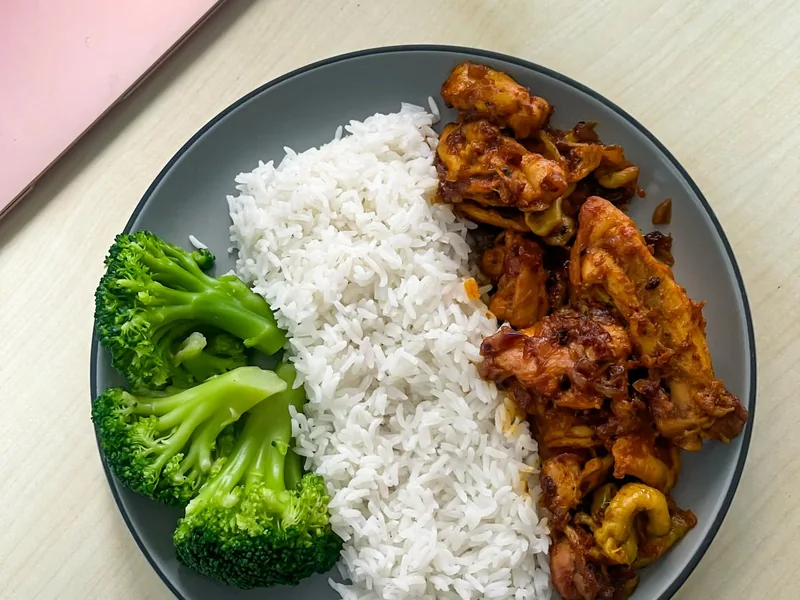

**Ingredients:** chicken • broccoli • brown rice • cheese. **Review:** Needs visual approval.  
**Photo:** Evans Joel / Pexels · Pexels License · [original source](https://www.pexels.com/photo/delicious-chicken-meal-with-rice-and-broccoli-36275016/). Images cropped to 4:3 for compact cards.

### 2. Lemon-Garlic Tilapia with Broccoli & Brown Rice

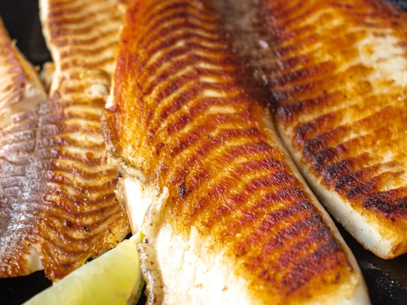

**Ingredients:** tilapia • broccoli • brown rice • lemon. **Review:** Needs visual approval.  
**Photo:** IARA MELO / Pexels · Pexels License · [original source](https://www.pexels.com/photo/grilled-tilapia-fillets-with-fresh-lime-wedges-30635698/). Images cropped to 4:3 for compact cards.

### 3. Honey-Garlic Chicken & Broccoli Rice Bowls

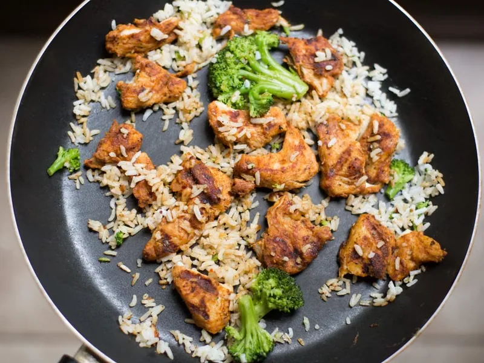

**Ingredients:** honey-garlic chicken • broccoli • rice. **Review:** Needs better plated-food image; current pan looks sparse..  
**Photo:** Keegan Evans / Pexels · Pexels License · [original source](https://www.pexels.com/photo/white-rice-chicken-and-broccoli-on-black-non-stick-pan-105588/). Images cropped to 4:3 for compact cards.

### 4. Turkey Taco Rice Bowls

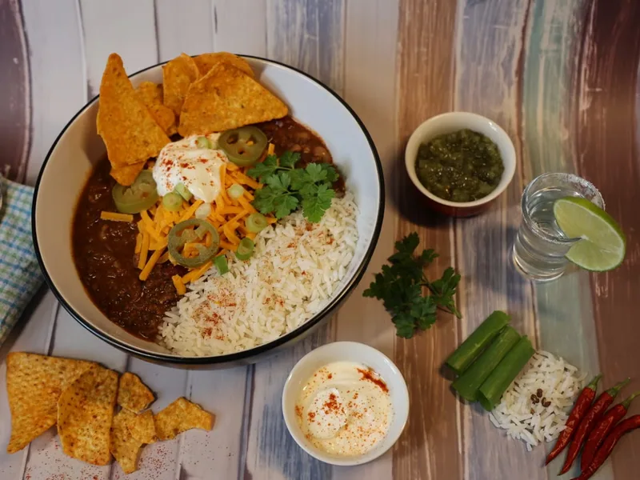

**Ingredients:** ground turkey • beans • corn • rice. **Review:** Needs visual approval.  
**Photo:** Steve House / Pexels · Pexels License · [original source](https://www.pexels.com/photo/bowl-with-mexican-food-14302291/). Images cropped to 4:3 for compact cards.

### 5. Sheet-Pan Sausage, Peppers & Potatoes

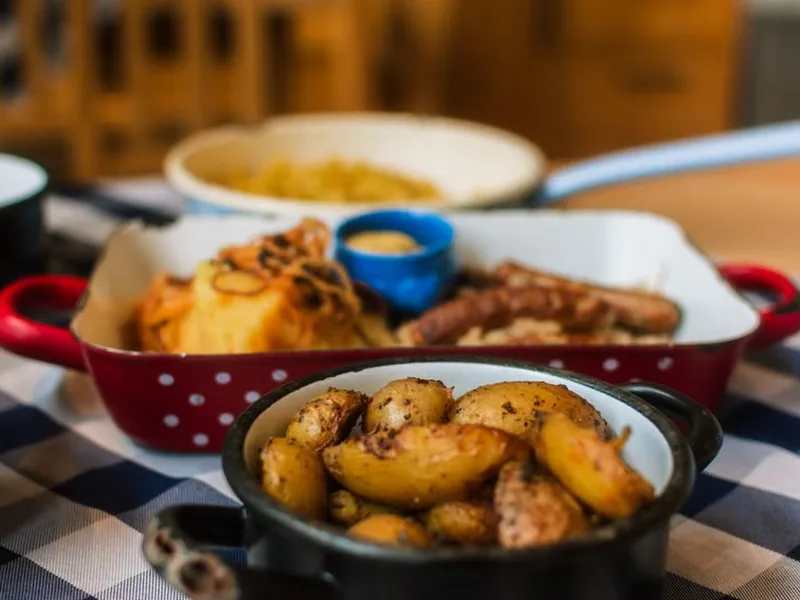

**Ingredients:** chicken sausage • potatoes • peppers • onion. **Review:** Replace: current photo does not resemble recipe..  
**Photo:** cami / Pexels · Pexels License · [original source](https://www.pexels.com/photo/rustic-potato-and-sausage-dish-on-checkered-cloth-37275057/). Images cropped to 4:3 for compact cards.

### 6. Spinach, Egg & Cheese Breakfast Wraps

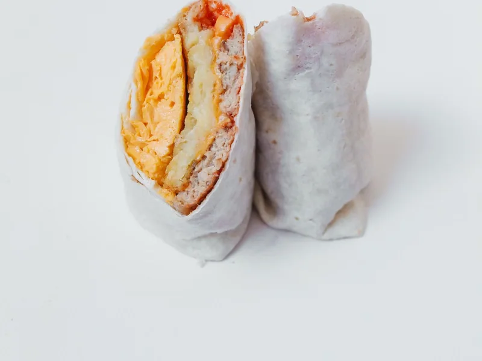

**Ingredients:** eggs • spinach • cheese • tortilla. **Review:** Needs visual approval.  
**Photo:** Polina Tankilevitch / Pexels · Pexels License · [original source](https://www.pexels.com/photo/wrap-with-chicken-and-cheese-5848057/). Images cropped to 4:3 for compact cards.

### 7. Tomato, Spinach & Chickpea Pasta

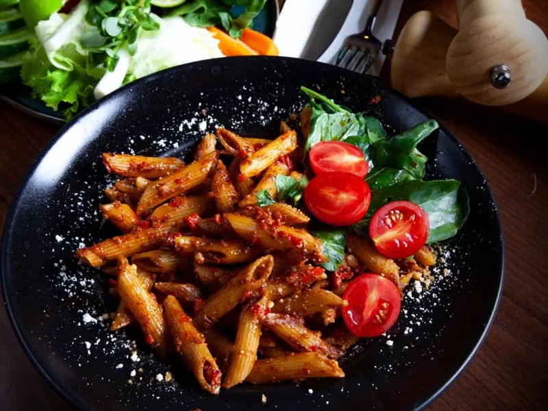

**Ingredients:** tomato pasta • spinach • chickpeas. **Review:** Replace: default lacks visible chickpeas/spinach. Generated fallback is not yet bundled..  
**Photo:** mustafa türkeri / Pexels · Pexels License · [original source](https://www.pexels.com/photo/tomato-pasta-on-a-black-plate-19805084/). Images cropped to 4:3 for compact cards.

### 8. Garlic Shrimp, Green Beans & Brown Rice

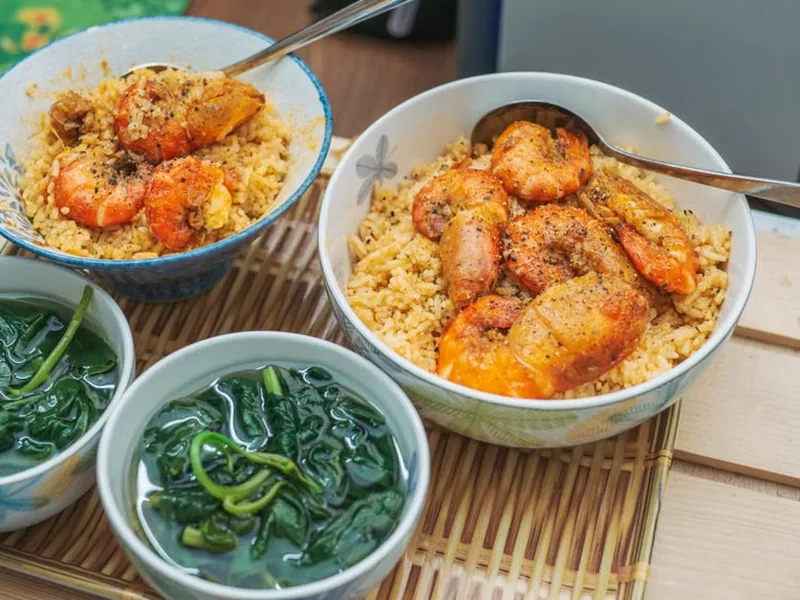

**Ingredients:** shrimp • green beans • brown rice. **Review:** New photo staged; shrimp and green beans shown, rice absent..  
**Photo:** PattayaPatrol · CC BY-SA 4.0 · [original source](https://commons.wikimedia.org/wiki/File:DFC_2196_Close-up_of_a_stir-fry_featuring_shrimp_tossed_with_sliced_green_beans_and_carrots_in_a_savory_sauce.jpg) · [license](https://creativecommons.org/licenses/by-sa/4.0/). Images cropped to 4:3 for compact cards.

### 9. Berry Overnight Oats

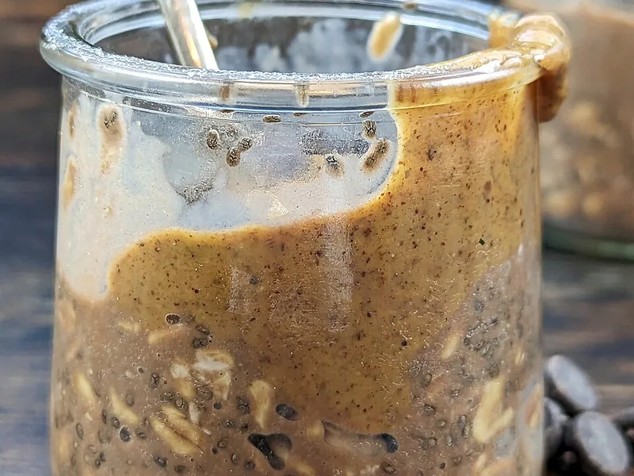

**Ingredients:** rolled oats • berries • chia • yogurt. **Review:** Needs visual approval.  
**Photo:** Livilla Latini / Pexels · Pexels License · [original source](https://www.pexels.com/photo/a-bowl-of-oatmeal-with-berries-and-milk-27850091/). Images cropped to 4:3 for compact cards.

### 10. Easy Chana Masala

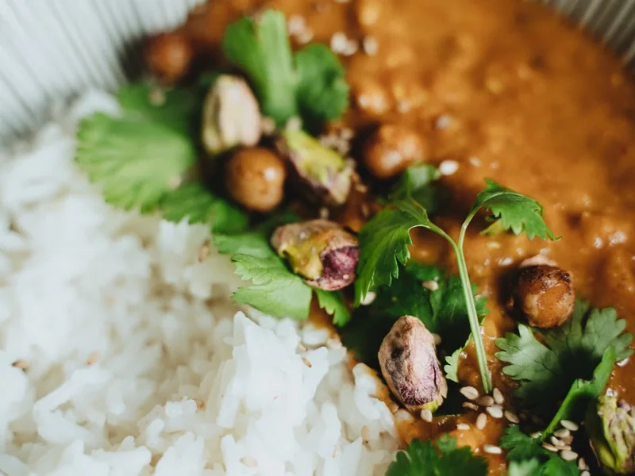

**Ingredients:** chickpeas • tomato • ginger • spices. **Review:** Needs visual approval.  
**Photo:** Alesia Kozik / Pexels · Pexels License · [original source](https://www.pexels.com/photo/food-healthy-beans-dinner-6544375/). Images cropped to 4:3 for compact cards.

### 11. Easy Vegetable Bibimbap

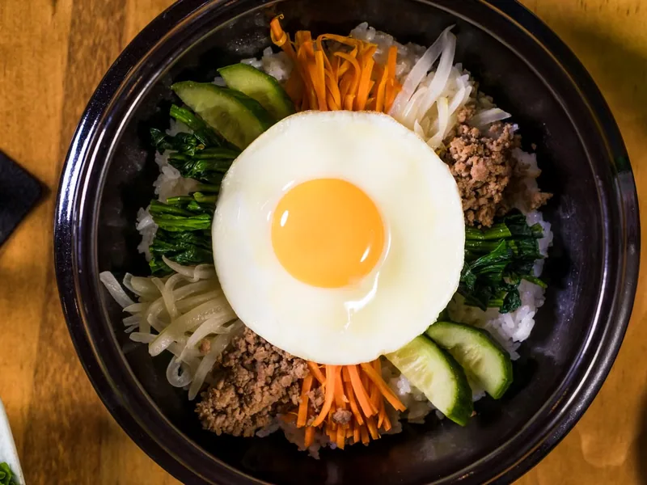

**Ingredients:** rice • egg • carrots • mushrooms • spinach. **Review:** Needs visual approval.  
**Photo:** Luis Becerra Fotógrafo / Pexels · Pexels License · [original source](https://www.pexels.com/photo/egg-on-top-of-a-bibimbap-5773960/). Images cropped to 4:3 for compact cards.

### 12. Chicken Teriyaki Rice Bowls

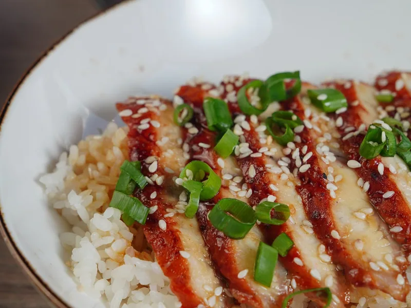

**Ingredients:** chicken • broccoli • rice • teriyaki. **Review:** Needs visual approval.  
**Photo:** Nadin Sh / Pexels · Pexels License · [original source](https://www.pexels.com/photo/delicious-teriyaki-chicken-rice-bowl-close-up-28442544/). Images cropped to 4:3 for compact cards.

### 13. Chicken Fajitas

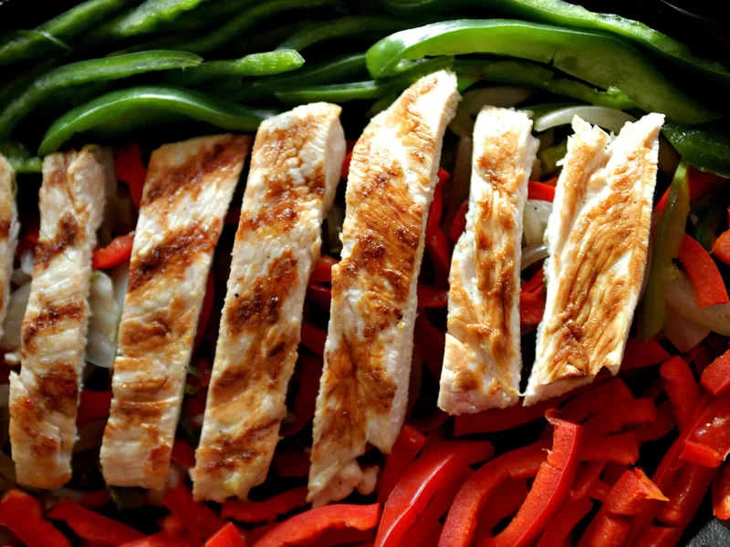

**Ingredients:** chicken • bell peppers • onion • tortillas. **Review:** Needs visual approval.  
**Photo:** DΛVΞ GΛRCIΛ / Pexels · Pexels License · [original source](https://www.pexels.com/photo/grilled-chicken-fajitas-with-fresh-peppers-32371267/). Images cropped to 4:3 for compact cards.

### 14. Filipino Chicken Adobo

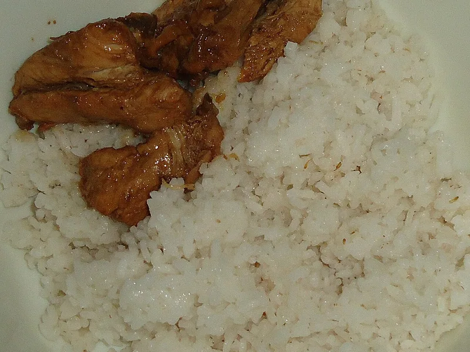

**Ingredients:** chicken • soy • vinegar • garlic • rice. **Review:** New photo staged; adobo and rice shown..  
**Photo:** Obsidian Soul · CC BY-SA 3.0 · [original source](https://commons.wikimedia.org/wiki/File:Filipino_Chicken_Adobo_with_rice.jpg) · [license](https://creativecommons.org/licenses/by-sa/3.0/). Images cropped to 4:3 for compact cards.

### 15. Cozy Lentil Vegetable Soup

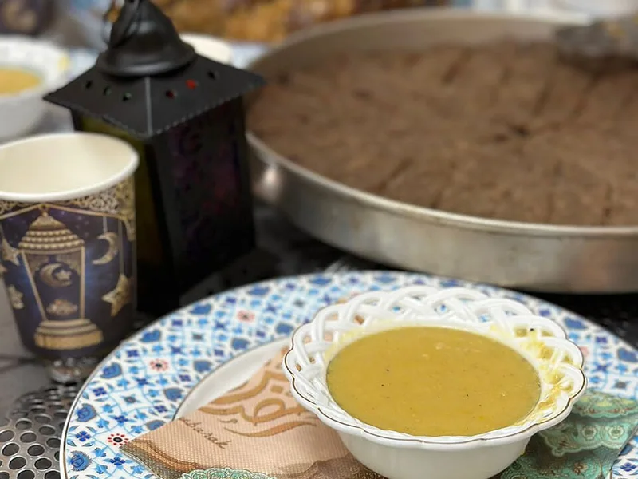

**Ingredients:** lentils • tomatoes • carrot • celery. **Review:** Needs visual approval.  
**Photo:** Lemur12 · CC BY-SA 3.0 · [original source](https://commons.wikimedia.org/wiki/File:Lentil_soup.JPG). Images cropped to 4:3 for compact cards.

### 16. Simple Japanese Onigiri

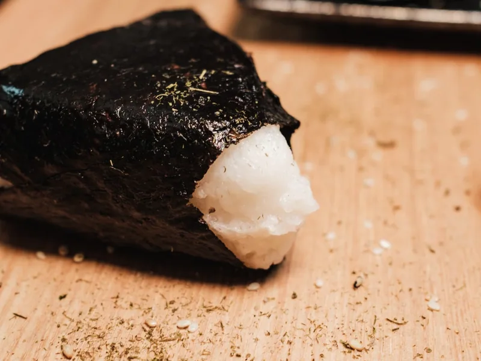

**Ingredients:** short-grain rice • nori • salt. **Review:** Needs visual approval.  
**Photo:** Airam Dato-on / Pexels · Pexels License · [original source](https://www.pexels.com/photo/delicious-onigiri-on-wooden-board-close-up-30874708/). Images cropped to 4:3 for compact cards.

### 17. Easy Tofu Pad Thai

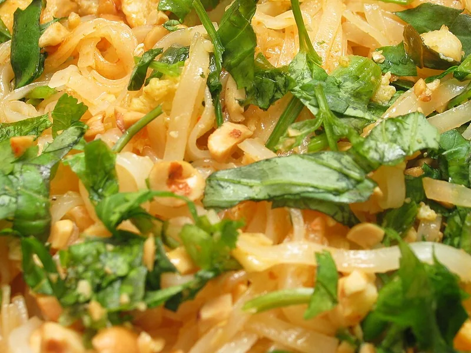

**Ingredients:** tofu • rice noodles • bean sprouts • peanuts. **Review:** Needs visual approval.  
**Photo:** Valeria Boltneva / Pexels · Pexels License · [original source](https://www.pexels.com/photo/delicious-pad-thai-with-tofu-and-fresh-herbs-32083373/). Images cropped to 4:3 for compact cards.

---

**Workflow for future batches:** If an imported/adapted recipe has an authenticated recipe source, use that page's image only if reuse is permitted. Otherwise use a visually accurate, free-license photo or an explicitly generated fallback. Record both the *recipe source* and *image source* separately; never assume an online photo is freely reusable. See [RECIPE_PHOTO_WORKFLOW.md](RECIPE_PHOTO_WORKFLOW.md).
